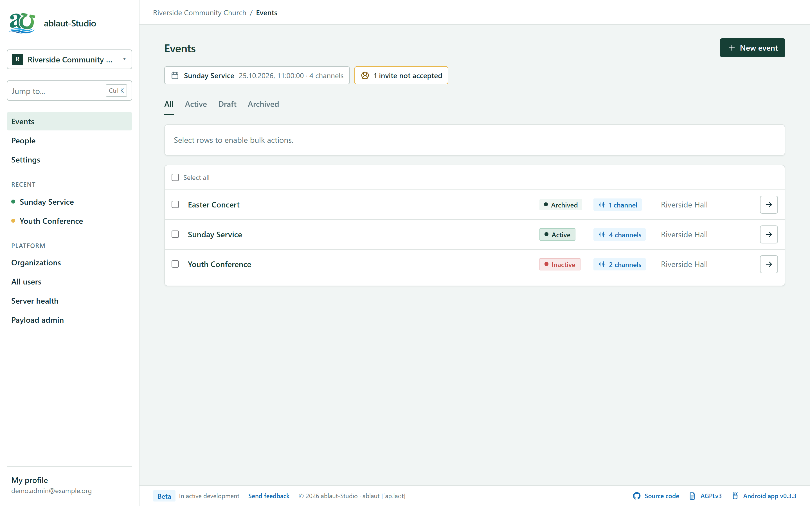
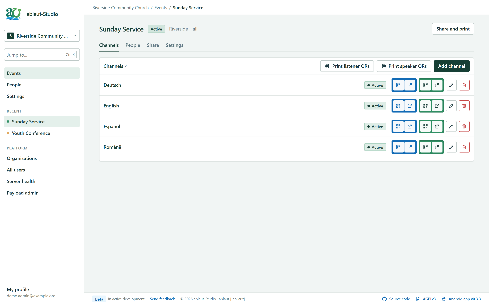
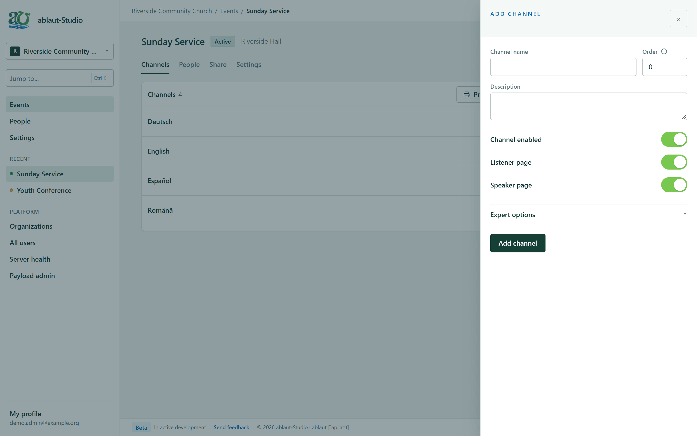
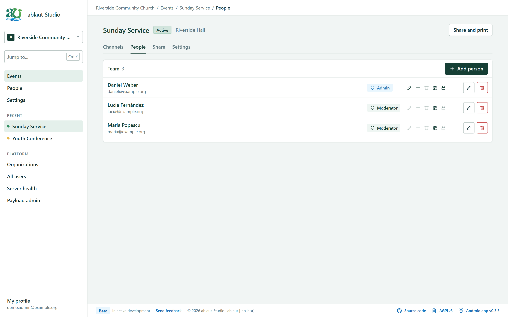
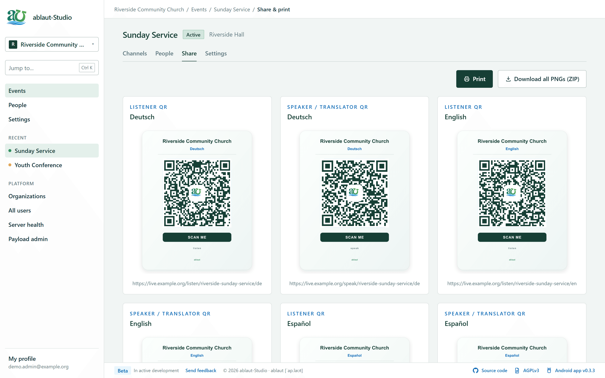
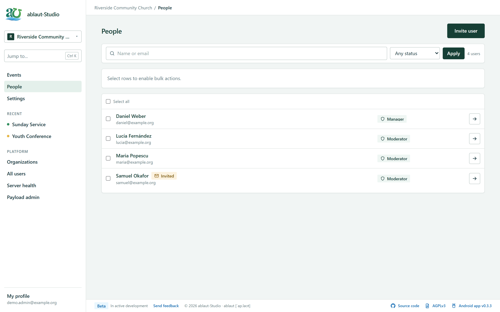
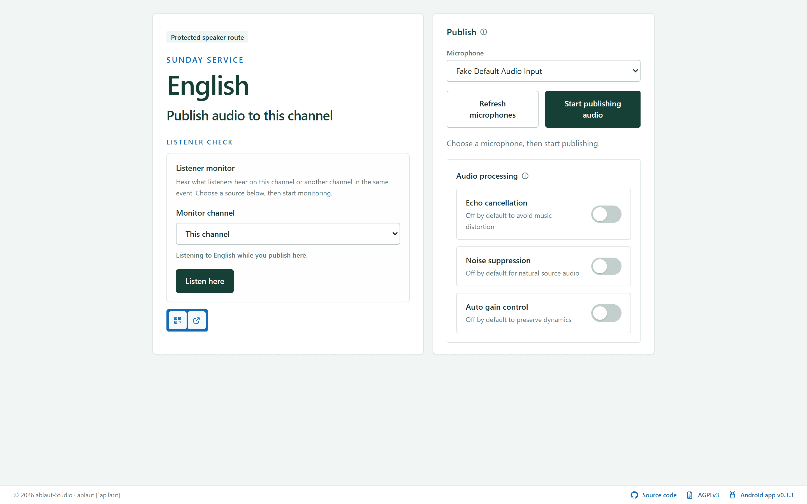
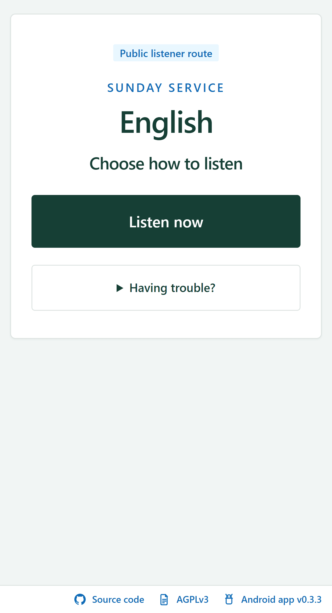

<p align=center></p>

  
  
  # ablaut

Self-hosted live translation and event audio management. 

[ablaut-App](https://github.com/silvansan/ablaut-App) as a receiver on Android phones.

iOS app to be released soon.

## ablaut `[ˈap.laʊt]` uses the `[aʊ]` mark for the logo - in linguistics, ablaut is a systematic variation of vowels within the same root or affix to indicate changes in grammatical function or meaning, particularly in Indo-European languages.

This project's goal to provide sub-second live translation or an assisted-listening solution for events, HOW, on-campus or out-of-campus non-profit organizations. The "ablaut" is connected in meaning to the core of the project on the linguistic side of things, as this project sprung from a need to cover the misunderstanding based of the variations in the Indo-European languages, but, of course, not only of the vowels. 

The back-end and the front-end: a [Payload CMS 3](https://github.com/payloadcms/payload) + Next.js app that creates events, channels, listener links, speaker links, QR codes. All this on top of [LiveKit](https://github.com/livekit/livekit) audio rooms. It is built to deploy as one Docker Compose stack with PostgreSQL and LiveKit included.


Built with Cursor-assisted development.

## Purpose

ablaut is intended to provide accessible live translation and event-audio tools for charity organizations, churches, community groups, and low-income associations.


The project is not intended to be commercially exploited in ways that take advantage of those communities. Commercial use is discouraged unless it directly supports this mission, contributes improvements back, or is arranged with the project maintainer.

## What It Does

- Host several organisations on one server, each with its own events, channels and people.
- Create events with one channel per language, then share listener and speaker links with QR codes.
- Print all listener or all speaker QR codes as a PDF, one per page, with the Android app QR on the last listener page.
- Turn on **Private links** for an event so its links use random codes instead of readable names, and rotate them when needed.
- Let speakers publish microphone audio through LiveKit, and listen back on any channel of the event.
- Let listeners connect from the browser or the [ablaut-App](https://github.com/silvansan/ablaut-App).
- Invite people by email. They set their own password from a one-time link and can request a new one from the sign-in page.
- Run locally, on LAN, or in the cloud from the same Compose stack.

## Roles

| Role | Can do |
| --- | --- |
| **Super admin** | Everything on the server: create and delete organisations, server settings, platform roles |
| **Platform admin** | Manage every organisation as if they were its manager |
| **Manager** | One organisation: its people, events, channels and settings |
| **Moderator** | Only the events they are assigned to, with per-event permissions (edit, add or delete channels, QR codes, speaker password) |

Every admin page carries the organisation in its address (`/o/<key>/events`), using a random 8-character key, so two organisations can use the same event and channel names.

## What's New in 0.5

- Left sidebar with an organisation switcher, recent events and a `Ctrl K` jump-to search.
- Event workspace with **Channels**, **People**, **Share** and **Settings** tabs. Channels and team members are added and edited in a side drawer that asks before discarding unsaved changes.
- Blue (listener) and green (speaker) QR and open buttons on every channel row, plus print-ready QR PDFs.
- One look for every list and form, with icons and tooltips instead of long explanations.
- Simpler roles: one role picker when inviting, and platform admins no longer get an organisation seat.
- Fixed in 0.5.1: links of channels added after Private links was turned on returned 404 (on the web and in the Android app).

## Stack

- Next.js 15
- Payload CMS 3
- TypeScript
- PostgreSQL
- LiveKit
- Docker Compose
- Tailwind CSS

## Quick Start

### Easy Portainer Deployment

Start here for a server install:

```text
PORTAINER_EASY_STACK_DEPLOYMENT.md
```

It includes the copy-paste stack flow, environment variables, proxy setup, and required ports. For the shortest path, paste `PORTAINER_STACK_COPY_PASTE.yml` into a Portainer stack and replace the `CHANGE_ME` values.

### Local Docker

```bash
cp .env.example .env
docker compose up -d --build
```

Open:

```text
http://localhost:3000
```

For LAN phone testing, open the app from your computer's LAN address instead:

```text
http://192.168.x.x:3000
```

QR codes use the host you opened the app with, so LAN URLs work on phones and cloud URLs work in production.

## Mobile App

Android APK downloads are published through the ablaut-App GitHub Releases page:

[CHECK THE LATEST RELEASE](https://github.com/silvansan/ablaut-App/releases)

## Included Services

- `app`: Next.js + Payload
- `db`: PostgreSQL
- `livekit`: self-hosted LiveKit WebRTC server
- `maildev`: optional local email catcher

Persistent volumes:

- `ablaut_db`
- `ablaut_uploads`

Do not delete these volumes during redeploys unless you intend to wipe data.

## Important Docs

- `docs/ARCHITECTURE.md`
- `docs/API.md`
- `docs/ROUTES.md`
- `docs/ORGANIZATIONS.md`
- `docs/SMTP_SETUP.md`
- `docs/LIVEKIT.md`
- `docs/DEPLOYMENT.md`
- `docs/PORTAINER.md`
- `PORTAINER_EASY_STACK_DEPLOYMENT.md`
- `PORTAINER_STACK_COPY_PASTE.yml`
- `PORTAINER_STACK_PINNED.yml`
- `docs/SECURITY.md`
- `docs/MIGRATION.md`
- `docs/ANDROID_COMPATIBILITY.md`
- `docs/TESTING.md`

## Production Notes

- Change every secret in `.env`.
- Use HTTPS in production.
- Point `PUBLIC_BASE_URL` and `NEXT_PUBLIC_APP_URL` to the public app URL.
- Point `LIVEKIT_URL` to the browser-reachable LiveKit WebSocket URL.
- Proxy `ablaut.example.com` to app port `3000`.
- Proxy `livekit.example.com` to LiveKit port `7880` with WebSocket support.
- Forward LiveKit RTC ports `7881/tcp` and `50000-50100/udp`.
- Back up `ablaut_db` and `ablaut_uploads`, and always back up before upgrading: database migrations run automatically when the new version starts.
- Configure SMTP so invitations and password resets are emailed (see `docs/SMTP_SETUP.md`). Without it, use **Copy invite link** or **Copy reset link** on a person's page and hand the link over yourself.
- Invite links last 7 days and reset links 60 minutes by default; change them with `INVITE_LINK_TTL_HOURS` and `RESET_LINK_TTL_MINUTES`.

## License

GNU Affero General Public License v3.0 or later (`AGPL-3.0-or-later`).

See `LICENSE`.


# Screenshots

Events of an organisation, with the next event and anything that needs attention at the top:



An event's channels: listener (blue) and speaker (green) QR codes, open buttons, and print-ready QR PDFs:



Adding a channel in the side drawer:



The event team, with each person's role and permissions as icons:



Share and print every QR code of an event:



People of an organisation, including pending invites:



The speaker page: pick a microphone, publish, and listen back on any channel:



The listener page on a phone:

<p align="center"></p>
